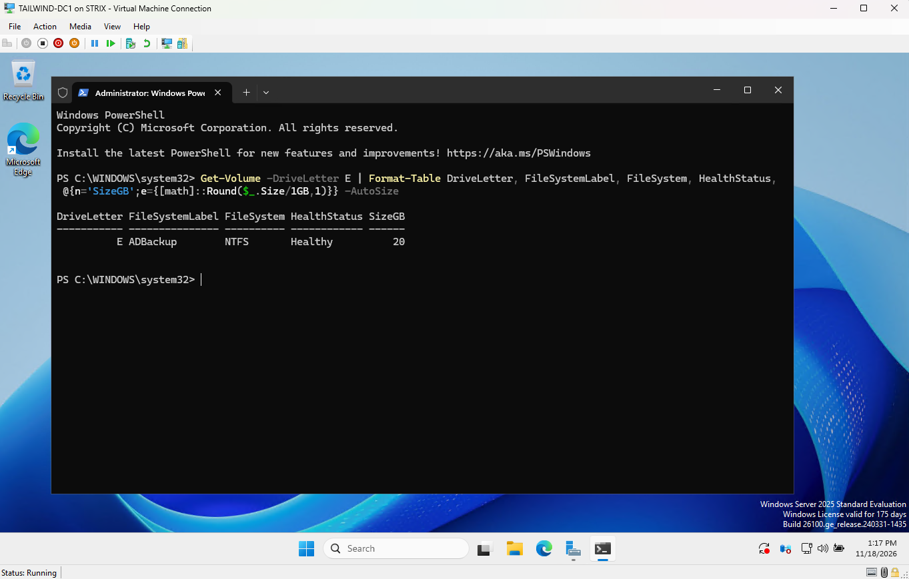
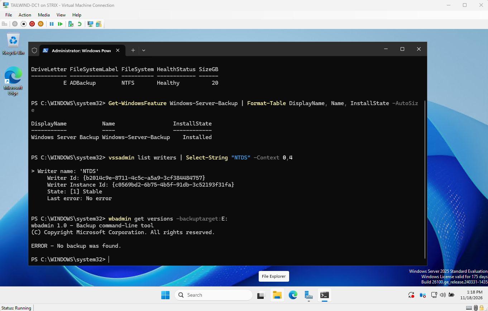
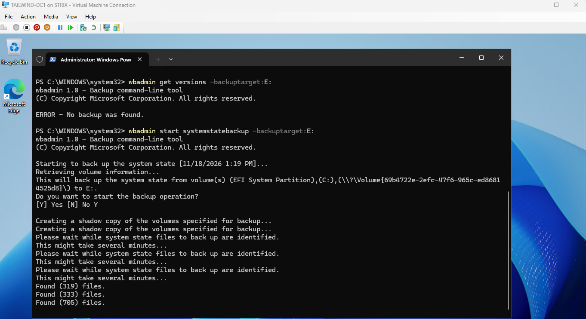
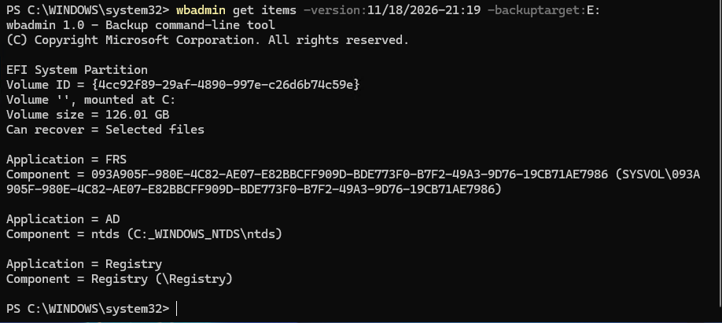
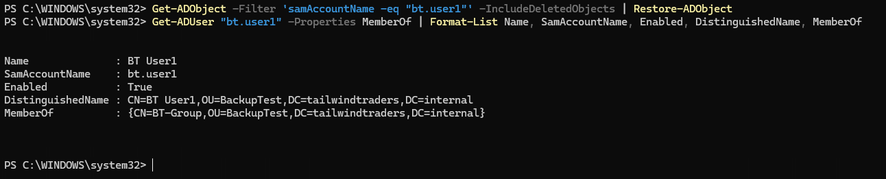
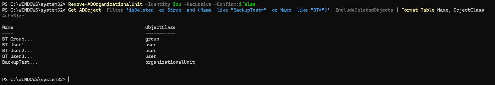
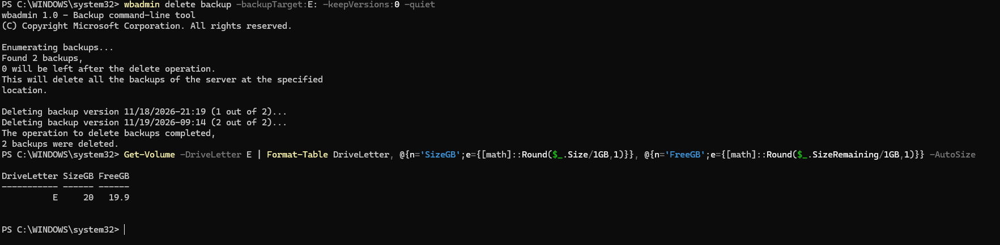
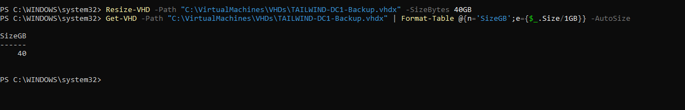
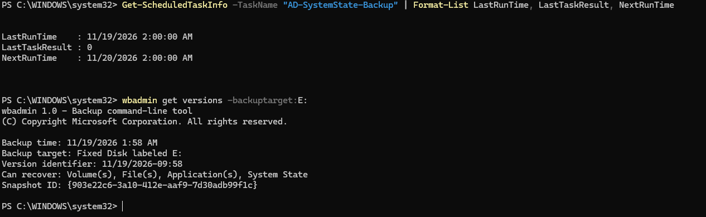

Active Directory Backup & Recovery

Hands-on lab: protecting a domain controller with System State backups, verifying what the backup contains, recovering deleted objects with the AD Recycle Bin, and automating a daily backup.

**Environment:** Hyper-V · Windows Server 2025 domain controller `TAILWIND-DC1` · Domain: `tailwindtraders.internal`  
**Tools:** Windows Server Backup, `wbadmin`, `vssadmin`, ActiveDirectory PowerShell module, AD Recycle Bin, Task Scheduler

| Recovery scenario | Method used |
|---|---|
| A user deleted by mistake | AD Recycle Bin (`Restore-ADObject`) |
| A whole OU deleted with its users and groups | AD Recycle Bin, restoring parent before children |
| DC failure or directory corruption | System State backup with Windows Server Backup |
| Scheduled backup failing | Diagnosis from backup and event logs, then freeing and resizing the backup target |

---

1.Dedicated backup disk

Backups go on a separate disk, not on the system volume, so they survive a failure of `C:`. A 20 GB VHDX was attached to the VM and formatted as `E:` (`ADBackup`).



2. Windows Server Backup

Installed the Windows Server Backup feature, which provides `wbadmin` and VSS-based, application-consistent backups.


3. Pre-backup checks

- **NTDS VSS writer** (the Active Directory writer): `State: [1] Stable`, `Last error: No error`. A failed writer means an inconsistent AD backup.
- **Backup catalog:** no previous backup on `E:`.

```powershell
vssadmin list writers | Select-String "NTDS" -Context 0,4
wbadmin get versions -backuptarget:E:
```



4. First System State backup

System State on a domain controller includes the AD database (`NTDS.dit`), SYSVOL, the registry, boot files, and AD-integrated DNS.

```powershell
wbadmin start systemstatebackup -backuptarget:E:
```

The backup created a VSS shadow copy, identified the system state files, and completed successfully.




5.Verifying the backup

A successful job is not enough: the backup has to be in the catalog and contain the right components.

```powershell
wbadmin get versions -backuptarget:E:
wbadmin get items -version:<version-id> -backuptarget:E:
```

The recovery point can restore **Volume(s), File(s), Application(s), and System State**, and includes:

| Application | Component |
|---|---|
| AD | `ntds` (the Active Directory database) |
| FRS | SYSVOL |
| Registry | `\Registry` |




6.AD Recycle Bin

The Recycle Bin restores deleted objects with **all their attributes**, including group memberships, without restoring the whole DC from backup. Enabling it is irreversible.

**Troubleshooting note:** running `Enable-ADOptionalFeature` returned *"The FSMO role ownership could not be verified because its directory partition has not replicated successfully with at least one replication partner."* The check showed:
- the Recycle Bin was **already enabled** forest-wide;
- the error came from the second domain controller (`TAILWIND-MBR1`) being **powered off**. Before a forest-wide operation, the FSMO role holder needs a successful replication with a partner.

```powershell
Get-ADOptionalFeature -Filter "Name -eq 'Recycle Bin Feature'" | Format-List Name, EnabledScopes
```


7. Test objects

Created an OU `BackupTest` with a security group `BT-Group` and three users, all members of the group.


8. Scenario: one user deleted by mistake

**Delete:** after `Remove-ADUser`, the user no longer exists in the domain. It appears in Deleted Objects as `BT User1 DEL:<GUID>`, with `Deleted: True` and `LastKnownParent: OU=BackupTest`.

```powershell
Remove-ADUser -Identity "bt.user1" -Confirm:$false
Get-ADObject -Filter 'isDeleted -eq $true -and samAccountName -eq "bt.user1"' -IncludeDeletedObjects -Properties samAccountName, LastKnownParent
```


**Restore:** the user is back in its original OU, enabled, and still a member of `BT-Group`.

```powershell
Get-ADObject -Filter 'samAccountName -eq "bt.user1"' -IncludeDeletedObjects | Restore-ADObject
```



9.Scenario: a whole OU deleted

**Delete:** `Remove-ADOrganizationalUnit -Recursive` removed the OU, the group, and all three users. All five objects moved to Deleted Objects.



**Restore:** order matters. The parent OU is restored first, then the objects whose `LastKnownParent` is that OU.

```powershell
Get-ADObject -Filter 'isDeleted -eq $true -and Name -like "BackupTest*"' -IncludeDeletedObjects | Restore-ADObject
Get-ADObject -Filter "LastKnownParent -eq '$ou'" -IncludeDeletedObjects | Restore-ADObject
```

All objects are back, and `BT-Group` again has its three members.


10. Automated daily backup

Registered a scheduled task that runs a System State backup every day at 02:00 as `SYSTEM`, then started it once to test it.

```powershell
$action  = New-ScheduledTaskAction -Execute "wbadmin.exe" -Argument "start systemstatebackup -backuptarget:E: -quiet"
$trigger = New-ScheduledTaskTrigger -Daily -At 2:00AM
Register-ScheduledTask -TaskName "AD-SystemState-Backup" -Action $action -Trigger $trigger -User "SYSTEM" -RunLevel Highest
Start-ScheduledTask -TaskName "AD-SystemState-Backup"
```


11. Troubleshooting: the scheduled backup failed

The test run of the scheduled task ended with *"The backup operation completed with errors. The backup of the system state failed."*


**Diagnosis:**
- The Windows Server Backup error log and the `Microsoft-Windows-Backup` event log showed **Event ID 7** (*completed with errors*).
- The backup target had **0.8 GB free out of 20 GB**: the first System State backup was about 19 GB, so there was no room for a second one.

```powershell
Get-Volume -DriveLetter E
Get-WinEvent -LogName "Microsoft-Windows-Backup" -MaxEvents 5
```


**Fix, part 1: free the target.** `wbadmin delete systemstatebackup` did not work, because the backup also contained the EFI System Partition (not System State only); `wbadmin delete backup` did. Free space went back to **19.9 GB**.

```powershell
wbadmin delete backup -backupTarget:E: -keepVersions:0 -quiet
```



**Fix, part 2: grow the backup disk to 40 GB.** A 20 GB target only fits one full System State backup, so I expanded the virtual disk.
- `Resize-VHD` failed with *"The process cannot access the file because it is being used by another process."*
- **Root cause:** Hyper-V checkpoints taken after the disk was attached. The VM was writing to differencing disks (`.avhdx`), so the parent `.vhdx` was locked.

```powershell
Get-VMSnapshot -VMName TAILWIND-DC1
Get-VMHardDiskDrive -VMName TAILWIND-DC1
```


Removed the checkpoints, waited for Hyper-V to merge the differencing disks back into the parent disks, then resized the disk on the host and extended the partition inside the DC.

```powershell
# Hyper-V host
Get-VMSnapshot -VMName TAILWIND-DC1 | Remove-VMSnapshot
Resize-VHD -Path "C:\VirtualMachines\VHDs\TAILWIND-DC1-Backup.vhdx" -SizeBytes 40GB
# Domain controller
Update-Disk -Number (Get-Partition -DriveLetter E).DiskNumber
Resize-Partition -DriveLetter E -Size (Get-PartitionSupportedSize -DriveLetter E).SizeMax
```





**Result:** the scheduled backup ran again and completed successfully.




**Lesson:** a System State backup of this DC is about 19 GB, so a 20 GB target holds one version only. In production the backup target must be sized for the retention you need (number of versions × backup size, plus headroom), and failed jobs must be monitored, not assumed to succeed.

---

## Key Takeaways

- Keep DC backups on a separate disk, and check the NTDS VSS writer before backing up.
- Verify the catalog and the components (NTDS, SYSVOL, registry), not just the job status.
- Use the AD Recycle Bin for deleted objects; it keeps group memberships and all attributes.
- When restoring a deleted OU, restore the parent first, then its children.
- Forest-wide operations need healthy replication: an offline DC can block them.
- A backup only helps if it runs regularly, so automate it and check the result.
- Size the backup target for the retention you need: a full disk silently breaks scheduled backups.
- A Hyper-V checkpoint is not a backup, and a disk with checkpoints cannot be resized until they are merged.
- DC backups contain password hashes: treat them as Tier 0 and restrict access.
