# AD Backup and Recovery

Backing up a domain controller, checking the backup is actually usable, restoring deleted objects, and scheduling it to run every night. The scheduled backup failed the first time, so the second half of this page is about fixing that.

- DC: `TAILWIND-DC1`, Windows Server 2025, on Hyper-V
- Domain: `tailwindtraders.internal` (there's a second DC, `TAILWIND-MBR1`, which was off for most of this)
- Tools: Windows Server Backup / `wbadmin`, `vssadmin`, AD PowerShell module, Task Scheduler

What I covered:

| Situation | How I handled it |
|---|---|
| One user deleted by mistake | AD Recycle Bin |
| A whole OU deleted, with users and a group | AD Recycle Bin, parent OU first, then the objects inside it |
| DC lost or directory corrupted | System State backup |
| Scheduled backup failing | Logs, then freeing and resizing the backup disk |

## 1. Separate disk for backups

If `C:` dies, the backups shouldn't die with it, so I added a 20 GB virtual disk to the VM and formatted it as `E:` (`ADBackup`).


## 2. Windows Server Backup

Installed the Windows Server Backup feature. It gives you `wbadmin` and uses VSS, so the AD database is backed up in a consistent state.

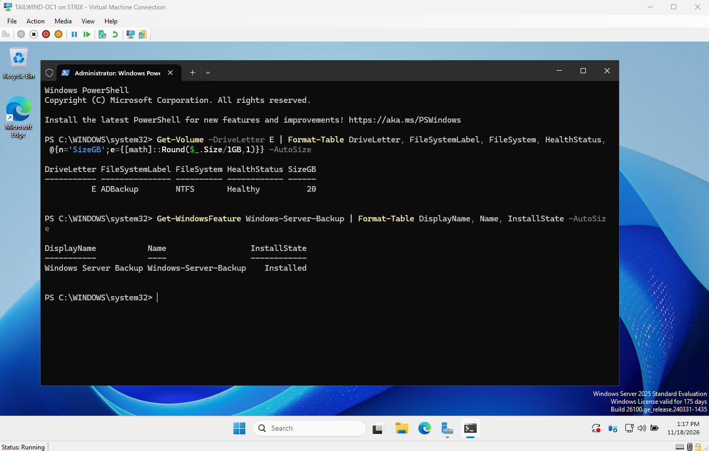

## 3. Checks before the first backup

The NTDS writer is the VSS writer for Active Directory. If it's in a failed state the AD part of the backup won't be consistent, so I checked it first: `Stable`, no error. The catalog on `E:` was empty, as expected.

```powershell
vssadmin list writers | Select-String "NTDS" -Context 0,4
wbadmin get versions -backuptarget:E:
```


## 4. First System State backup

On a DC, System State includes `NTDS.dit`, SYSVOL, the registry, boot files and AD-integrated DNS.

```powershell
wbadmin start systemstatebackup -backuptarget:E:
```

Most of the time went into the "identifying files" phase (it found over 90,000 files) before it started copying. It finished without errors.


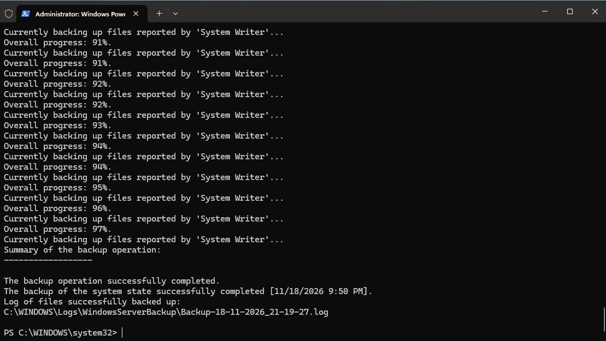

## 5. Checking what's in the backup

"Completed successfully" doesn't prove much on its own, so I looked at the catalog and the items inside the version:

```powershell
wbadmin get versions -backuptarget:E:
wbadmin get items -version:<version-id> -backuptarget:E:
```

It can restore volumes, files, applications and System State, and it contains the three things that matter on a DC:

| Application | Component |
|---|---|
| AD | `ntds` |
| FRS | SYSVOL |
| Registry | `\Registry` |

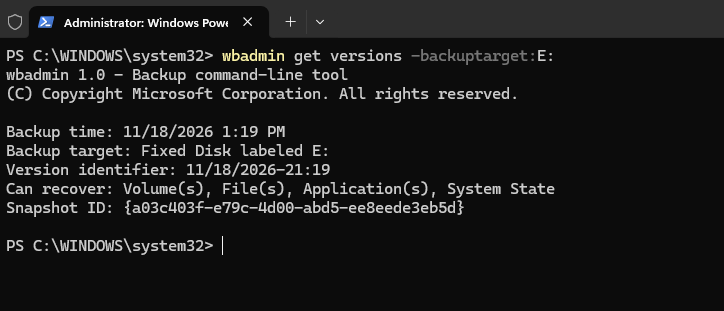


## 6. AD Recycle Bin

With the Recycle Bin on, a deleted object comes back with all its attributes, group memberships included, and you don't have to touch the backup. Once enabled it can't be turned off.

When I ran `Enable-ADOptionalFeature` I got this:

> The FSMO role ownership could not be verified because its directory partition has not replicated successfully with at least one replication partner

Turned out two things were going on. The Recycle Bin was already enabled for the forest, and the error itself came from `TAILWIND-MBR1` being powered off. Before a forest-wide change the role holder wants to replicate with a partner first, and it couldn't.

```powershell
Get-ADOptionalFeature -Filter "Name -eq 'Recycle Bin Feature'" | Format-List Name, EnabledScopes
```

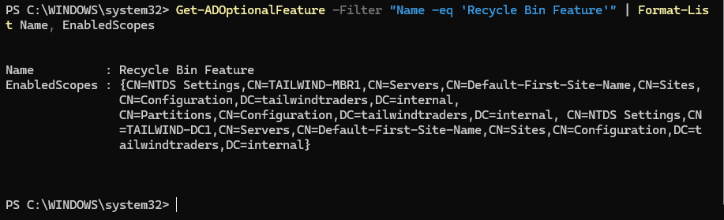

## 7. Test objects

An OU called `BackupTest`, a group `BT-Group`, and three users in the group.

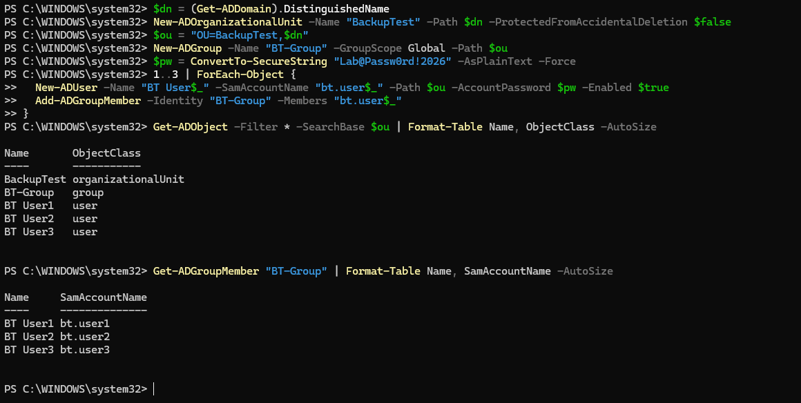

## 8. Restoring one deleted user

After `Remove-ADUser` the user is gone from the domain and shows up in Deleted Objects as `BT User1 DEL:<GUID>`, with `LastKnownParent` pointing to `OU=BackupTest`.

```powershell
Remove-ADUser -Identity "bt.user1" -Confirm:$false
Get-ADObject -Filter 'isDeleted -eq $true -and samAccountName -eq "bt.user1"' -IncludeDeletedObjects -Properties samAccountName, LastKnownParent
```

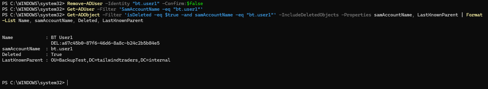

Restored it, and it came back in the same OU, enabled and still in `BT-Group`:

```powershell
Get-ADObject -Filter 'samAccountName -eq "bt.user1"' -IncludeDeletedObjects | Restore-ADObject
```


## 9. Restoring a whole OU

`Remove-ADOrganizationalUnit -Recursive` took out the OU, the group and the three users, five objects in total.


The order matters here. The OU has to come back first, otherwise the users and the group have nowhere to go. Then you restore everything whose `LastKnownParent` is that OU.

```powershell
Get-ADObject -Filter 'isDeleted -eq $true -and Name -like "BackupTest*"' -IncludeDeletedObjects | Restore-ADObject
Get-ADObject -Filter "LastKnownParent -eq '$ou'" -IncludeDeletedObjects | Restore-ADObject
```

Everything was back, and the group still had its three members.

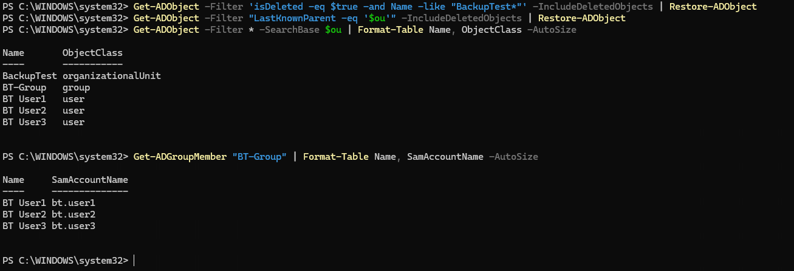

## 10. Daily backup with Task Scheduler

A task that runs the System State backup every night at 02:00 as `SYSTEM`. I started it once by hand to test it.

```powershell
$action  = New-ScheduledTaskAction -Execute "wbadmin.exe" -Argument "start systemstatebackup -backuptarget:E: -quiet"
$trigger = New-ScheduledTaskTrigger -Daily -At 2:00AM
Register-ScheduledTask -TaskName "AD-SystemState-Backup" -Action $action -Trigger $trigger -User "SYSTEM" -RunLevel Highest
Start-ScheduledTask -TaskName "AD-SystemState-Backup"
```

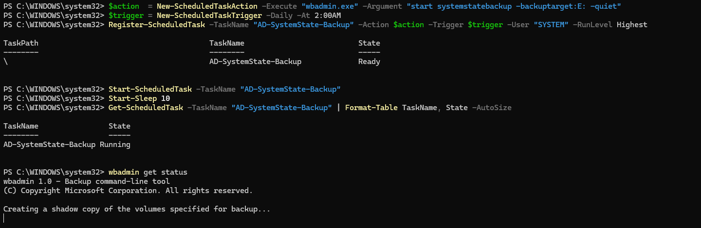

## 11. The scheduled backup failed

The test run ended with "The backup of the system state failed".

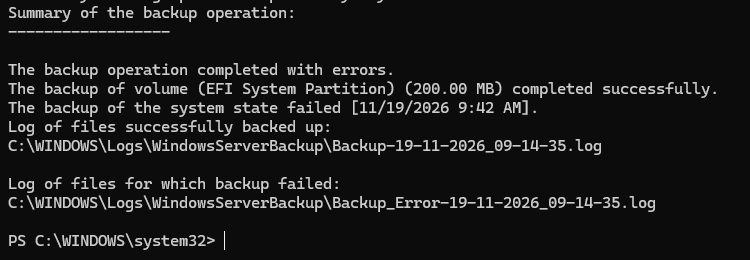

The backup log and the `Microsoft-Windows-Backup` event log (Event ID 7, completed with errors) didn't say much, but the target disk did: 0.8 GB free out of 20 GB. The first backup was around 19 GB and there was no room for another one.

```powershell
Get-Volume -DriveLetter E
Get-WinEvent -LogName "Microsoft-Windows-Backup" -MaxEvents 5
```

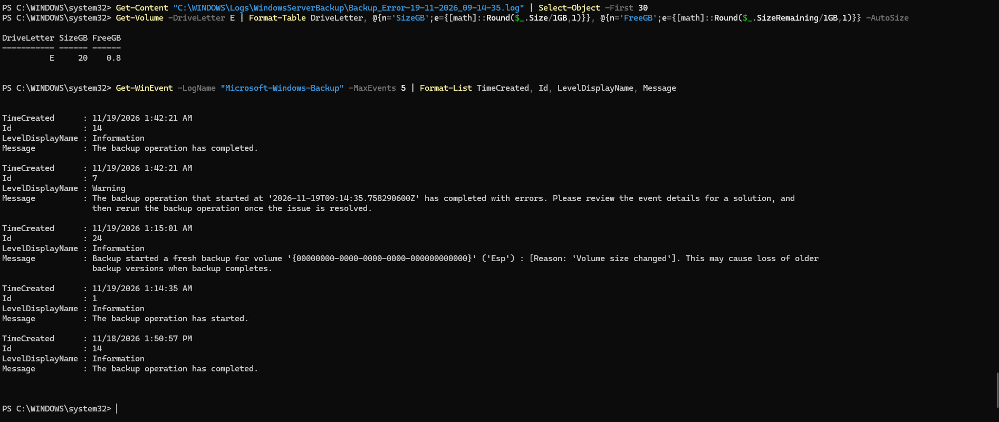

**Freeing the disk.** `wbadmin delete systemstatebackup` refused, because the backup also included the EFI System Partition and that command only deletes System State-only backups. `wbadmin delete backup` worked and got me back to 19.9 GB free.

```powershell
wbadmin delete backup -backupTarget:E: -keepVersions:0 -quiet
```


**Growing the disk to 40 GB.** 20 GB only holds one full backup, so I wanted more room. `Resize-VHD` failed with "The process cannot access the file because it is being used by another process."

The cause was Hyper-V checkpoints taken after I had attached the disk. The VM was writing to `.avhdx` differencing disks and the original `.vhdx` was locked.

```powershell
Get-VMSnapshot -VMName TAILWIND-DC1
Get-VMHardDiskDrive -VMName TAILWIND-DC1
```

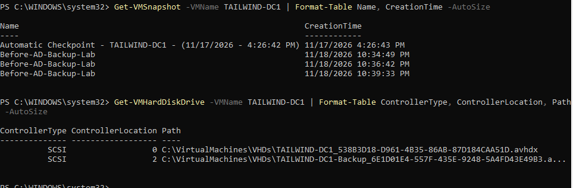

I deleted the checkpoints, waited for the merge to finish, resized the disk on the host and extended the partition inside the DC:

```powershell
# on the Hyper-V host
Get-VMSnapshot -VMName TAILWIND-DC1 | Remove-VMSnapshot
Resize-VHD -Path "C:\VirtualMachines\VHDs\TAILWIND-DC1-Backup.vhdx" -SizeBytes 40GB
# on the DC
Update-Disk -Number (Get-Partition -DriveLetter E).DiskNumber
Resize-Partition -DriveLetter E -Size (Get-PartitionSupportedSize -DriveLetter E).SizeMax
```

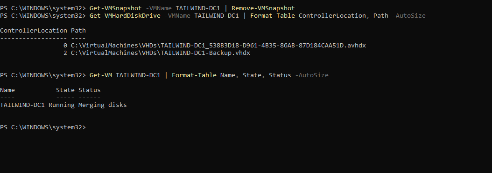


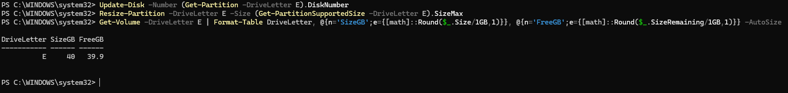

After that the scheduled backup ran fine. `LastTaskResult` is 0 and the next run is set for 02:00.

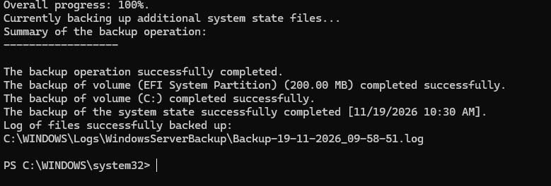


## Notes

- Keep DC backups on their own disk and check the NTDS writer before backing up.
- Look at what's inside the backup, not just the job status.
- Recycle Bin for deleted objects, backup for real damage. Restore the parent OU before its children.
- An offline DC can block forest-wide changes like enabling the Recycle Bin.
- Size the backup disk for how many versions you want to keep. A full disk just makes the job fail quietly.
- Hyper-V checkpoints aren't backups, and a disk with checkpoints can't be resized until they're merged.
- DC backups contain password hashes, so they need the same protection as the DC itself.
