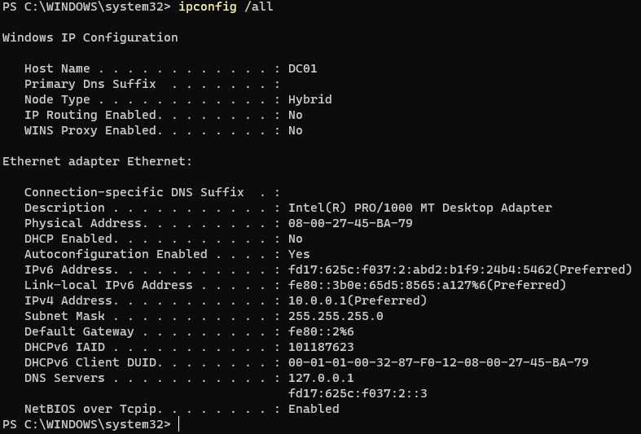
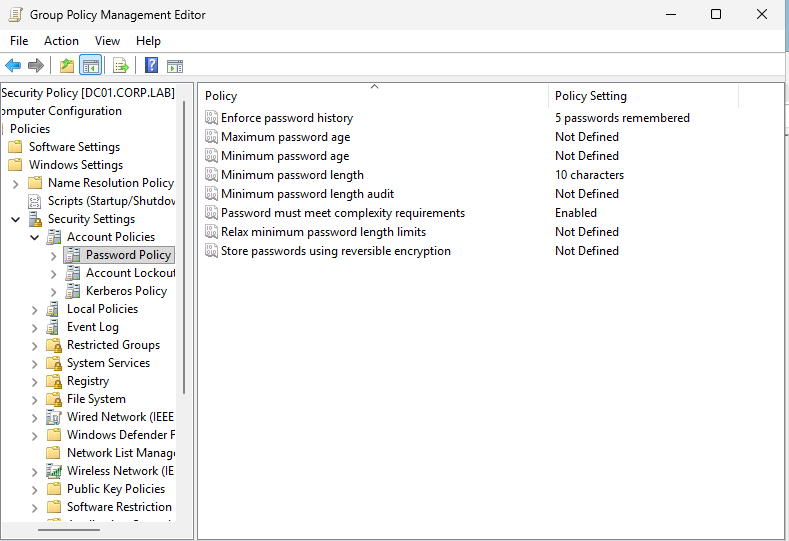

# Active Directory Domain with Group Policy

Building a domain from a blank Windows Server: users by department, a couple of account problems to fix, a password policy, bulk user creation with PowerShell, and DHCP at the end. Based on the NextWork project of the same name.

- DC: `DC01`, Windows Server 2025, static IP `10.0.0.1/24`
- Domain: `corp.lab` (NetBIOS `CORP`)
- Ran in VirtualBox

## 1. Setting up the domain

Renamed the server to DC01, gave it a static IP and pointed DNS to `127.0.0.1`, since the DC runs its own DNS. Installed AD DS with the management tools, created the forest `corp.lab` and promoted the server.

`Get-ADDomainController` confirmed DC01 is a Global Catalog and holds the FSMO roles.




## 2. OUs, users and groups

One OU per department (IT, HR, Sales), users in each, and a security group per department, for example `Sales Staff`. With OUs you can find people quickly and target GPOs per team. With groups you give access once and then just add or remove people when they join or leave.


## 3. The accounts were disabled

After creating the users, all of them showed up as disabled. They had been created with `New-ADUser` without a password, and AD won't enable an account whose password doesn't meet the domain policy, so it leaves it disabled.

I fixed them in a loop:

```powershell
Set-ADAccountPassword -Identity $user -NewPassword $pw -Reset   # set a password that meets the policy
Enable-ADAccount      -Identity $user                           # enable the account
Set-ADUser            -Identity $user -ChangePasswordAtLogon $true  # user changes it at first logon
```


## 4. Password policy GPO

Created a GPO called Corp Security Policy, linked it to the domain and set the password and lockout rules. Password side: minimum 10 characters, complexity on, last 5 passwords remembered. Forced an update and checked it with `gpresult /r`.




## 5. Bulk users from a CSV

Made a CSV with 7 new hires and a PowerShell script that creates each one in the right department OU. The script finished with "Bulk user creation complete. Total users processed: 7" and then listed every user with username, department and status.

The total count was 3 higher than I expected. Those are the built-in accounts every domain gets: Administrator, Guest (disabled by default) and krbtgt (disabled, used by Kerberos to sign tickets).


## 6. Extra: DHCP with reservations

Installed the DHCP Server role, authorized it in AD, created a scope for `10.0.0.0` and reserved two addresses by MAC:
- `10.0.0.110` for the office printer
- `10.0.0.120` for the file server

Authorizing the server in AD matters because a Windows DHCP server won't hand out leases until it's authorized. That's what stops a rogue DHCP server from giving out bad addresses.


## Notes

- Static IP and DNS on the DC come first.
- Accounts created without a valid password stay disabled. Easy to miss when scripting.
- A GPO linked at the domain level covers everyone, so test it before linking.
- DHCP needs to be authorized in AD or it won't serve anything.

Original write-up on NextWork: [Active Directory Domain with Group Policy](https://nextwork.ai/calm_gray_heroic_grape/docs/a59b9091-bfbf-465b-ac45-1efa93b68388)
