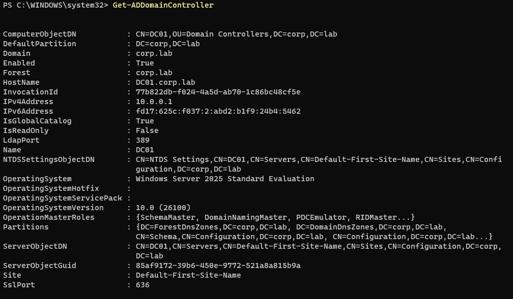
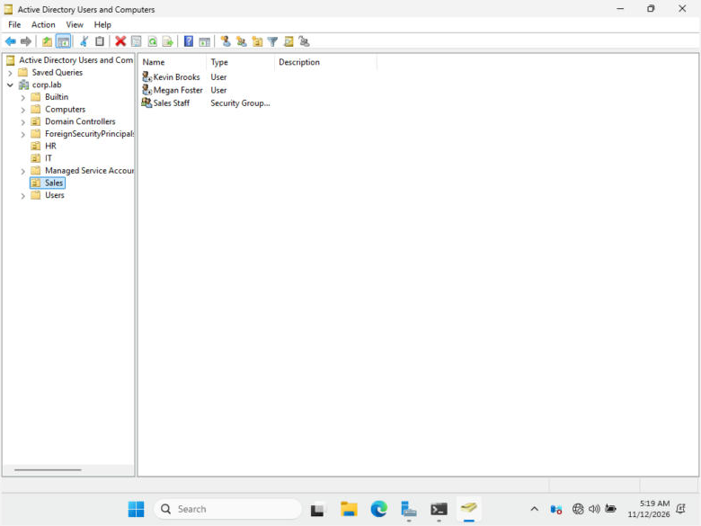
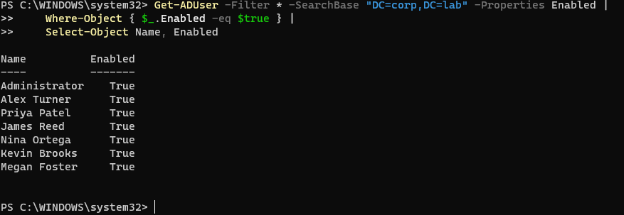
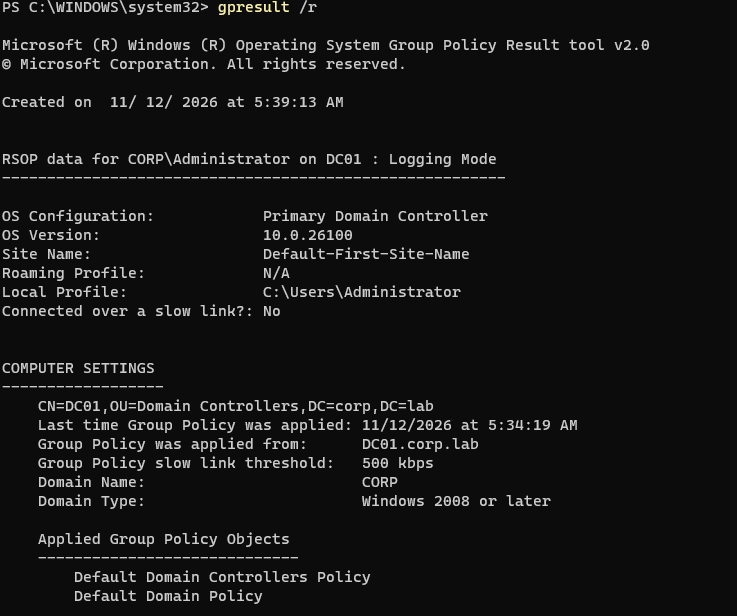
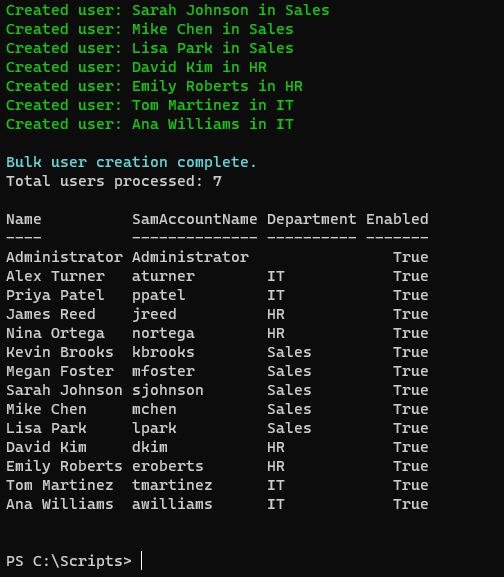
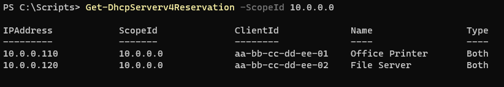

# Active Directory Domain with Group Policy

Hands-on lab: building an Active Directory domain from a blank Windows Server, organizing users by department, fixing account issues, enforcing a domain-wide security policy, automating user provisioning with PowerShell, and configuring DHCP.

**Environment:** Windows Server 2025 (Domain Controller `DC01`, `10.0.0.1/24`) · Domain: `corp.lab` (NetBIOS: `CORP`)  
**Tools:** AD DS, DNS, Active Directory Users and Computers, Group Policy Management, PowerShell (ActiveDirectory and DhcpServer modules), `gpresult`, DHCP Server

---

## 1. Setting Up the Active Directory Domain

- Renamed the server to **DC01** and configured a **static IP** (`10.0.0.1`), with DNS pointing to `127.0.0.1`, because the domain controller runs its own DNS service.
- Installed the **AD DS** role with management tools, created a new forest **corp.lab** (NetBIOS name `CORP`), and promoted the server to a **Domain Controller**.
- Verified the result with `Get-ADDomainController`: DC01 is a Global Catalog and holds the FSMO roles.




## 2. Building the Organizational Structure

- Created **IT**, **HR**, and **Sales** Organizational Units, added users to each department, and created department **security groups** (e.g. `Sales Staff`).
- **Why it matters:** OUs organize users by department, so they are easy to find and the right Group Policy can be applied to each team. Security groups grant access once to a whole team; people are then simply added or removed as they join or leave.



## 3. Account and Password Management

**Problem:** the new accounts were disabled.  
**Root cause:** they were created with `New-ADUser` without a password. Active Directory will not enable an account that has no password meeting the domain's password policy, so it creates the account in a disabled state.

**Fix**, applied to each account in a loop:

```powershell
Set-ADAccountPassword -Identity $user -NewPassword $pw -Reset   # set a compliant password
Enable-ADAccount      -Identity $user                           # turn the account on
Set-ADUser            -Identity $user -ChangePasswordAtLogon $true  # user picks own password at first logon
```



## 4. Enforcing Security with Group Policy

- Created and linked a **Corp Security Policy** GPO to the domain, configuring password and account lockout policies, then forced it to apply.
- Password policy settings: **minimum length 10 characters**, **complexity enabled**, **password history: 5 passwords remembered**.
- Verified Group Policy processing on DC01 with `gpresult /r`.




## 5. Automating Bulk User Provisioning with PowerShell

- Built a **CSV file** with seven new hires and wrote a **PowerShell script** that creates each user in the correct department OU.
- Script output: *"Bulk user creation complete. Total users processed: 7"*, followed by a verification listing every user with SamAccountName, department, and enabled status.
- **User count check:** the 3 extra accounts in the domain are built-in ones created automatically with the domain: **Administrator** (the active domain admin), **Guest** (disabled by default for security), and **krbtgt** (a disabled account Kerberos uses to sign authentication tickets).



## 6. Secret Mission: DHCP with IP Reservations

- Installed the **DHCP Server** role, **authorized** it in Active Directory, created a scope for the lab network (`10.0.0.0`), and added **IP reservations** by MAC address:
  - `10.0.0.110`: Office Printer
  - `10.0.0.120`: File Server
- **Why DHCP authorization matters:** it stops rogue DHCP servers from handing out wrong IP addresses. A Windows DHCP server only leases IPs after an admin authorizes it in AD.



---

## Key Takeaways

- A domain controller needs a static IP and its own DNS before AD DS can work reliably.
- OUs define where policies apply; security groups define who gets access.
- Accounts created without a compliant password stay disabled until a password is set.
- A domain-level GPO enforces password and lockout rules for every user.
- PowerShell + CSV turns onboarding into a repeatable, verifiable process.
- DHCP authorization in AD protects the network from rogue DHCP servers.

📄 Original project write-up on NextWork: [Active Directory Domain with Group Policy](https://nextwork.ai/calm_gray_heroic_grape/docs/a59b9091-bfbf-465b-ac45-1efa93b68388)
