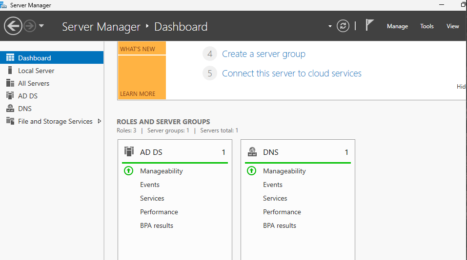
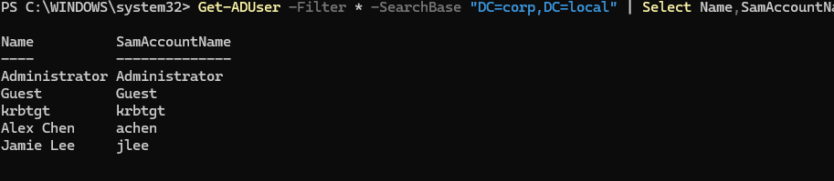
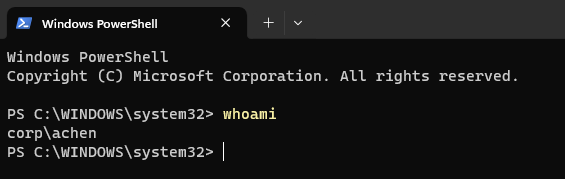
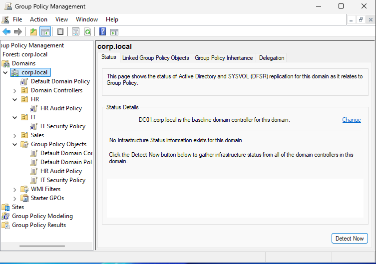
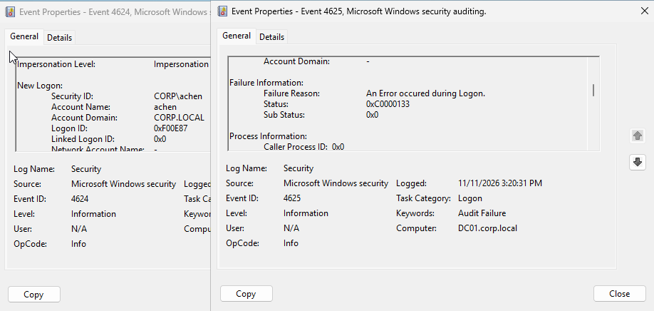
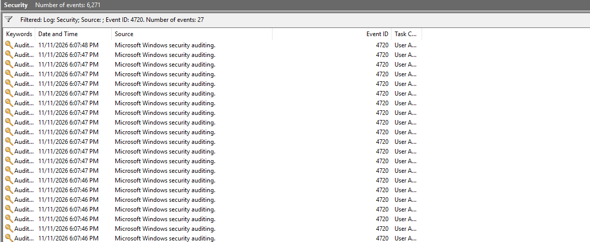

# AD Security Monitoring

A domain built from scratch, then locked down per department and monitored. I followed the NextWork "Build an Active Directory Domain" project and added my own notes.

- DC: `DC01`, Windows Server 2025
- Domain: `corp.local`
- Also used: a Windows client VM joined to the domain

## 1. Promoting the DC

Static IP first, with DNS pointing to `127.0.0.1`. Once the server is promoted it becomes its own DNS server, and AD doesn't work without DNS (that's how clients find the DC). Then I installed AD DS and created the new forest `corp.local`.

## 2. OUs, groups and users

I created IT, HR and Sales OUs, a security group for each department, and some test users. Quick reminder to myself: OUs are where you link policies, groups are how you give access to resources.

Checked the users with `Get-ADUser` and logged in from the client as `corp\achen`:

## 3. Different GPOs per department

IT accounts are more sensitive than HR ones, so they got stricter rules:

| GPO | Linked to | What it does |
|---|---|---|
| IT Security Policy | IT OU | Stricter password rules, logon auditing (success and failure) |
| HR Audit Policy | HR OU | Audits account management changes (creating or modifying users) |

Checked that they actually applied with `gpupdate /force`, `gpresult /r` and `auditpol /get /category:*`.

## 4. Watching the DC

In Performance Monitor I added `% Processor Time`, `% Processor Utility` and `NTDS\LDAP Searches/sec` to see the load on DC01.

In the Security log I looked at the two logon events:
- 4624 is a successful logon (shows the account, logon type and source)
- 4625 is a failed logon. A lot of these for the same account in a short time usually means someone is guessing passwords.

## 5. Bulk users with PowerShell

The script reads new users from a CSV. Usernames are the first letter of the first name plus the last name, lowercase (Alex Chen becomes `achen`).

Every new account writes Event ID 4720 ("A user account was created"), so filtering on 4720 gives you an audit trail of who created what and when. After the script ran I could see 27 accounts there.

## Notes

- Get DNS right before anything else.
- Link GPOs to OUs, give access through groups.
- 4624, 4625 and 4720 are the events I'd watch first.
- Bulk creation from a CSV is fast and still shows up in the logs, which is what you want.

Original write-up on NextWork: [Build an Active Directory Domain](https://nextwork.ai/calm_gray_heroic_grape/docs/f092376e-8722-4eb5-926c-e1bb7517ec07)
