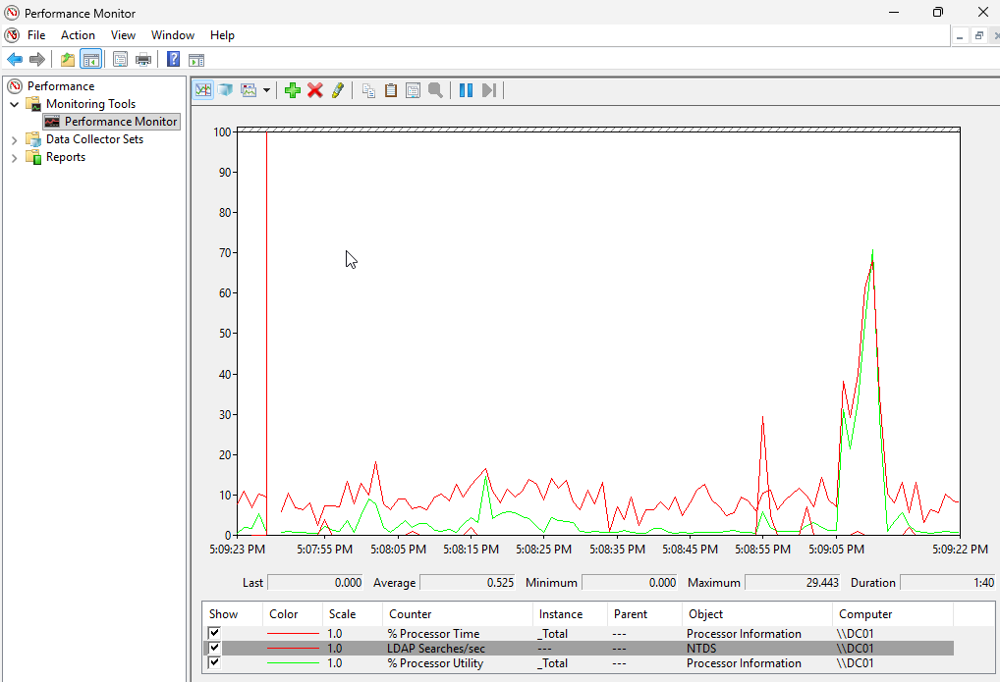

# Build an Active Directory Domain – Security Monitoring

Hands-on lab: deploying a Windows Server domain with OUs, department-specific GPOs, security auditing, performance monitoring, and PowerShell bulk user provisioning.

**Environment:** Windows Server 2025 (Domain Controller `DC01`) · Windows client VM · Domain: `corp.local`  
**Tools:** AD DS, DNS, Server Manager, Group Policy Management Console, PowerShell (ActiveDirectory module), Performance Monitor, Event Viewer, `gpupdate`, `gpresult`, `auditpol`

---

## 1. Promoting Windows Server to a Domain Controller

- Assigned a static IP and pointed DNS to `127.0.0.1`: once promoted, the server becomes its own DNS server. Active Directory depends on DNS, and it is how other computers locate the Domain Controller.
- Installed the **AD DS** role and promoted the server to a Domain Controller for a new forest: **corp.local**.

## 2. Organizational Structure: OUs, Groups, and Users

- Created **IT**, **HR**, and **Sales** Organizational Units, department security groups, and test users.
- **OU vs. Security Group:** OUs are used to apply policies; security groups are used to grant access to resources.
- Verified the users with PowerShell and confirmed a domain logon as `corp\achen`.

## 3. Differentiated Group Policies per Department

Each department gets security controls that match its level of risk:

| GPO | Linked to | Purpose |
|---|---|---|
| **IT Security Policy** | IT OU | Strict password rules and logon auditing (success and failure) |
| **HR Audit Policy** | HR OU | Account management auditing (successful changes, such as creating or modifying user accounts) |

Policy application was verified with `gpupdate /force`, `gpresult /r`, and `auditpol /get /category:*`.

## 4. Monitoring Domain Controller Health and Security Events

- **Performance Monitor:** tracked `% Processor Time`, `% Processor Utility`, and `NTDS\LDAP Searches/sec` on DC01 to observe authentication load.
- **Event Viewer (Security log):**
  - **4624**: successful logon (account, logon type, source).
  - **4625**: failed logon. Many 4625 events for one account can indicate a brute-force attempt.

## 5. Automating Bulk User Creation with PowerShell

- Imported new users from a CSV file with a PowerShell script.
- **SamAccountName logic:** first letter of the first name + full last name, in lowercase (e.g. Alex Chen → `achen`).
- **Audit trail:** each new account generates **Event ID 4720** (*A user account was created*). Filtering the Security log on 4720 showed **27 accounts** created by the script, recording who created which accounts and when.

---

## Key Takeaways

- AD DS depends on correctly configured DNS.
- Use OUs for policy scope and security groups for access to resources.
- Apply security controls based on department risk.
- Event IDs 4624, 4625, and 4720 are core signals for authentication and account auditing.
- PowerShell bulk provisioning saves time and remains fully auditable.

📄 Original project write-up on NextWork: [Build an Active Directory Domain](https://nextwork.ai/calm_gray_heroic_grape/docs/f092376e-8722-4eb5-926c-e1bb7517ec07)
